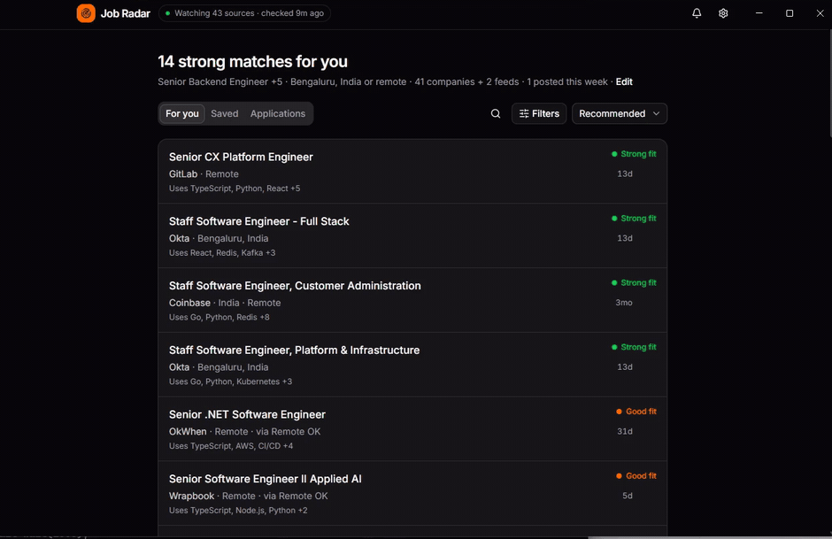
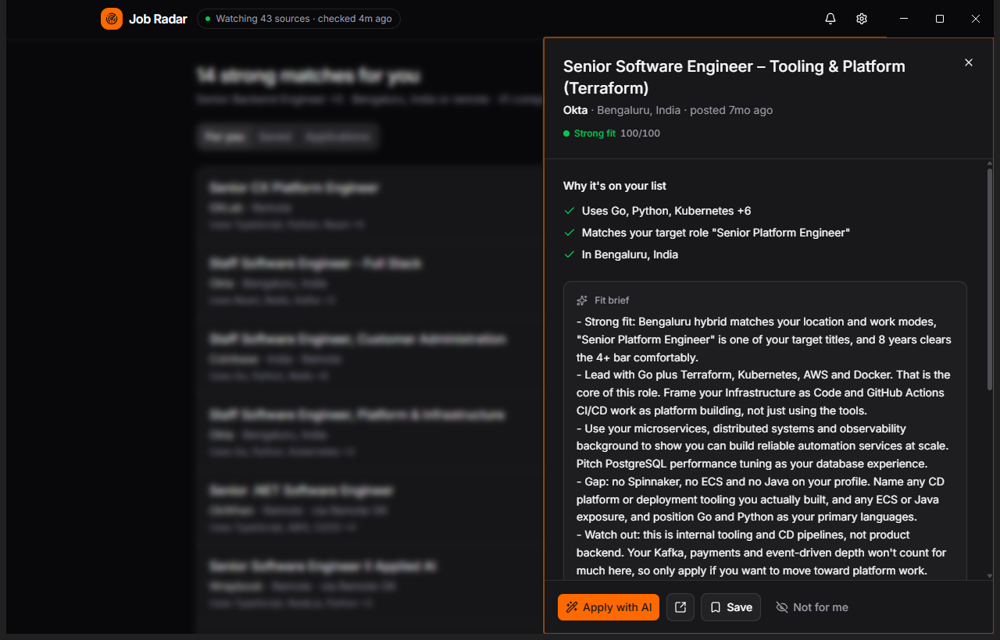
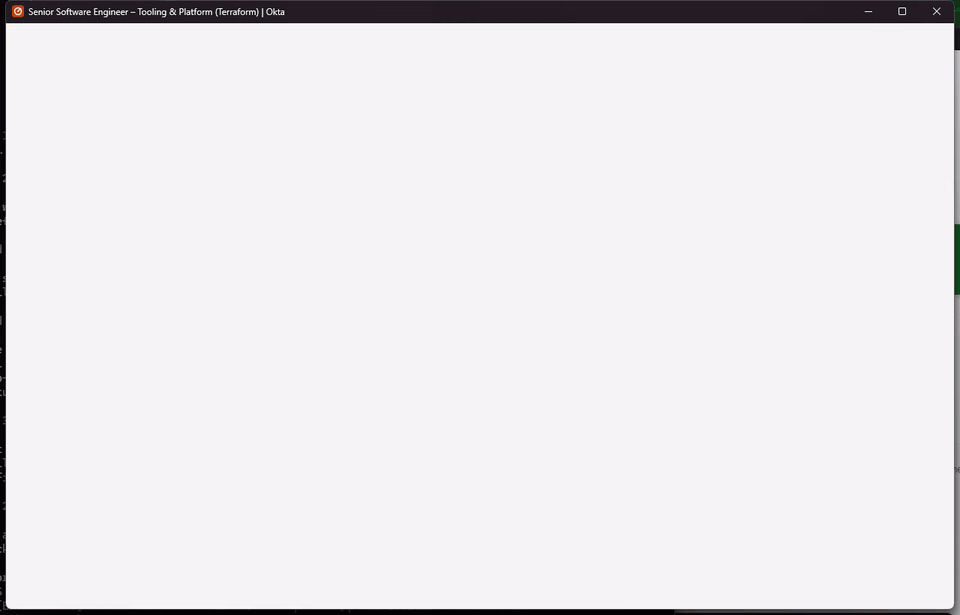

<div align="center">
  <picture>
    <source media="(prefers-color-scheme: dark)" srcset="docs/media/logos/job-radar-dark.svg">
    
  </picture>
  <h3>Jobs that fit you, the moment they're posted.</h3>
  <p>
    A desktop app that watches company job boards, ranks every posting against your resume,<br/>
    and fills in applications with Claude. Built on <a href="https://www.rivet.dev">Rivet Actors</a>.
  </p>
  <p>
    <a href="#install">Install</a> •
    <a href="#features">Features</a> •
    <a href="#built-with-rivet">How it works</a> •
    <a href="#develop">Develop</a>
  </p>
  <p>
    
    <a href="https://www.rivet.dev"></a>
    
    
    
  </p>
</div>



## Features

- **New jobs within minutes.** Follows 41 companies out of the box, plus any company you name, on Greenhouse, Lever, Ashby, SmartRecruiters, Workable, Recruitee, Personio, Remote OK and Hacker News.
- **Ranked for you.** Scores every posting on your skills, target roles, level, location and visa needs. A fit brief from Claude says what to lead with and what's missing.
- **Applies with you.** Opens the real application, fills it, attaches your resume and remembers your answers for next time. It flags any answer it had to estimate and anything only you can answer.
- **Auto-apply, optional.** Prepares applications for new strong matches in the background, and can submit the complete ones for you within a daily limit.
- **Private.** No account and no server. Everything stays on your computer, and one click deletes it.

<table>
  <tr>
    <td width="50%"></td>
    <td width="50%"></td>
  </tr>
  <tr>
    <td align="center">Fit brief</td>
    <td align="center">Apply with AI</td>
  </tr>
</table>

## Install

Download the latest build from [Releases](../../releases):

| System | File |
| --- | --- |
| Windows 10 and 11 | `JobRadar-Setup-<version>.exe` |
| macOS | `JobRadar-<version>-mac-<arch>.dmg` |
| Linux | `JobRadar-<version>-linux-x64.AppImage` |

On first launch, connect Claude with [Claude Code](https://claude.com/claude-code) or an Anthropic API key, add your resume, and pick companies to watch. Builds are not code-signed yet, so Windows and macOS warn on first launch.

## Built with Rivet

<a href="https://www.rivet.dev">
  <picture>
    <source media="(prefers-color-scheme: dark)" srcset="docs/media/logos/rivet-white.svg">
    
  </picture>
</a>

Job Radar's backend is three [Rivet Actors](https://www.rivet.dev/docs), each with its own SQLite database and schedule. The app runs a Rivet engine locally, so nothing needs a server.

| Actor | One per | Does |
| --- | --- | --- |
| `board` | company job board | polls on its own alarm, diffs postings, scores new ones for each follower and pushes matches |
| `seeker` | person | keeps the profile, matches and saved answers, drafts applications, sends reminders |
| `directory` | install | tracks board health for the status pill |

A board is fetched once however many people follow it, sleeps between polls, and goes dormant when nobody follows it.

## Develop

Requires Node 22+, pnpm, Rust, and a [rivet-dev/rivet](https://github.com/rivet-dev/rivet) checkout next to this folder with the engine built.

```bash
export RIVET_ENGINE_BINARY_PATH=../rivet/target/release/rivet-engine   # .exe on Windows
pnpm install
pnpm desktop   # run the app from source
pnpm test      # run the tests
pnpm release   # build installers for this OS
```

Pushing a tag such as `v0.1.2` runs [the release workflow](.github/workflows/release.yml), which builds Windows, macOS and Linux and publishes them to Releases.
